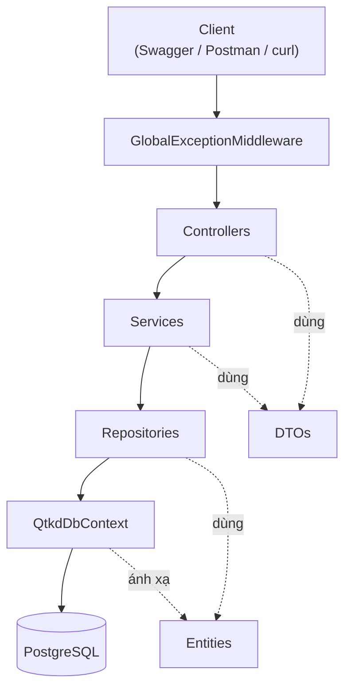
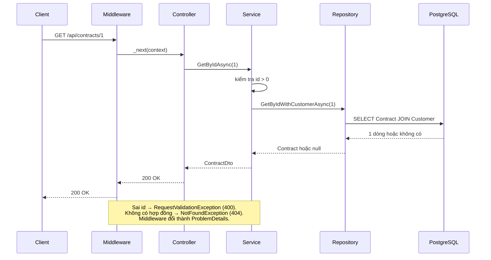

# Kiến trúc QTKD — Tuần 05

API quản trị kinh doanh theo kiến trúc phân lớp: Controller → Service → Repository → DbContext → PostgreSQL.

## 1. Sơ đồ thành phần

| Lớp | Trách nhiệm | Không làm |
|---|---|---|
| Controller | Nhận HTTP request, gọi Service, trả response và status code | Nghiệp vụ, truy cập DbContext |
| Service | Validation đầu vào, ném exception nghiệp vụ, chuyển Entity thành DTO | Xử lý HTTP, viết truy vấn EF |
| Repository | Truy vấn EF Core (LINQ), trả Entity | Validation, biết về DTO |
| DbContext | Ánh xạ bảng, quan hệ, ràng buộc | |
| Middleware | Chuyển exception thành response lỗi thống nhất | Nghiệp vụ |

Các lớp được nối bằng Dependency Injection, đăng ký trong `Program.cs`. Entity không lộ ra ngoài API: Controller chỉ trả DTO (`CustomerDto`, `ContractDto`).

## 2. Luồng xử lý `GET /api/contracts/1`

Truy vấn dùng `async/await` vì đây là thao tác I/O: trong lúc chờ PostgreSQL, thread được trả lại để phục vụ request khác.

## 3. Xử lý lỗi

| Tình huống | Nơi phát hiện | Kết quả |
|---|---|---|
| `GET /api/contracts/abc` (sai kiểu) | `[ApiController]` model binding | `400` + `errors.id` |
| `GET /api/contracts/0`, `/-1` | `ContractService` ném `RequestValidationException` | `400` ProblemDetails |
| `GET /api/contracts/9999` | `ContractService` ném `NotFoundException` | `404` ProblemDetails |
| Lỗi bất ngờ (mất kết nối DB, bảng chưa tồn tại...) | `GlobalExceptionMiddleware` | `500`, thông báo chung cho client |

Lỗi 500 không trả chi tiết exception cho client để tránh lộ cấu trúc hệ thống; chi tiết nằm trong log, đối chiếu bằng `traceId` trong response.

## 4. Quyết định thiết kế

**Repository.** Tách Repository để Service không phụ thuộc EF Core (có thể kiểm thử bằng repository giả mà không cần database) và để truy vấn nằm một chỗ. Đánh đổi: thêm file và một lớp trung gian. Repository trả `Task<Entity>` / `IReadOnlyList<Entity>`, không trả `IQueryable`, để không làm lộ chi tiết truy vấn ra ngoài. Mỗi repository chỉ có các phương thức đang được dùng.

**Dữ liệu.**
- `PriceItem` dùng khóa chính kép `(PriceListId, ServiceCode)`: một dịch vụ không xuất hiện hai lần trong cùng bảng giá.
- Customer–Contract đặt `OnDelete(Restrict)`: không xóa được khách hàng đang có hợp đồng. PriceList–PriceItem đặt `Cascade`: dòng giá không có ý nghĩa nếu thiếu bảng giá.
- Trạng thái lưu dạng chuỗi (`Draft`, `Active`...) để dễ đọc trong PostgreSQL và khi đối chiếu với response của API.
- Ngày hiệu lực dùng `DateOnly` (kiểu `date` trong PostgreSQL), tránh lỗi múi giờ.
- Check constraint ở database (`StartDate <= EndDate`, `UnitPrice >= 0`) là lớp bảo vệ cuối cùng, độc lập với code nghiệp vụ.
- Các trường lấy theo gợi ý tối thiểu của đặc tả Phase 2; tên trạng thái hợp đồng theo đặc tả đó.

**Cấu hình.** Chuỗi kết nối trong `appsettings.json` không chứa mật khẩu; mật khẩu đặt bằng User Secrets hoặc biến môi trường. Dữ liệu mẫu (`DbSeeder`) chỉ chạy ở môi trường Development, chỉ khi database đã migrate, và không thêm trùng.