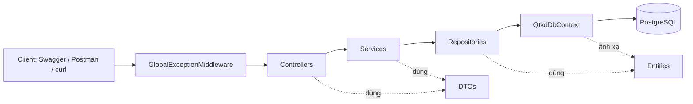
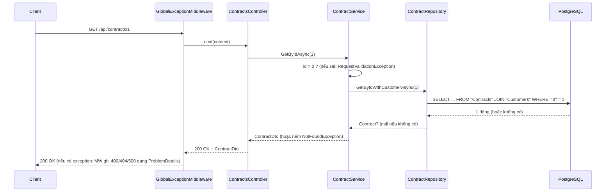

# Kiến trúc QTKD — Tuần 05

Tài liệu này giải thích các quyết định thiết kế để bạn trình bày được khi demo (Phase 1 yêu cầu giải thích được code, không chỉ chạy được).

## 1. Đối chiếu với cấu trúc mục tiêu của Phase 1 (TH4)

| Yêu cầu TH4 | Thể hiện trong dự án |
|---|---|
| Controllers / DTOs / Entities / Services / Repositories / Data / Exceptions-Middleware / Program.cs | Đủ các thư mục cùng tên trong `src/QTKD.Api/` |
| Controller không truy cập DbContext trực tiếp | Controller chỉ nhận `ICustomerService`, `IContractService` |
| DTO thay Entity ở request/response | `CustomerDto`, `ContractDto`; Entity không lộ ra ngoài API |
| Tách Repository và giải thích lợi ích/trade-off | `ICustomerRepository`, `IContractRepository`; xem mục 4 |
| Validation rõ vị trí, lỗi dễ hiểu cho client | Kiểm tra `id > 0` ở `ContractService`; id sai kiểu do `[ApiController]` trả 400 |
| Cơ chế xử lý exception thống nhất | `GlobalExceptionMiddleware` + `NotFoundException`, `RequestValidationException` |
| DI nối Controller → Service → Repository | Đăng ký trong `Program.cs`, mục "Dependency Injection" |
| Giữ hành vi endpoint | Chỉ 2 endpoint đọc; hành vi ổn định, kiểm bằng bảng test |
| EF Core migration, connection string không hard-code mật khẩu | Migration tạo schema; mật khẩu qua User Secrets/biến môi trường |
| Swagger gọi được endpoint | Swagger UI tại `/swagger` (Development) |

## 2. Các lớp và trách nhiệm

| Lớp | Việc làm | Việc KHÔNG làm |
|---|---|---|
| Controller | Nhận HTTP request, gọi Service, trả HTTP response + status code | Không viết nghiệp vụ, không dùng DbContext |
| Service | Validation đầu vào, ném exception nghiệp vụ, chuyển Entity → DTO | Không biết HTTP, không viết truy vấn EF |
| Repository | Truy vấn EF Core (LINQ), trả Entity | Không validation, không biết DTO |
| DbContext | Cấu hình ánh xạ bảng, quan hệ, ràng buộc | |
| Middleware | Biến exception thành response lỗi thống nhất | Không chứa nghiệp vụ |

## 3. Luồng một request: `GET /api/contracts/1`

Điểm cần nắm: `await` giải phóng thread trong lúc chờ I/O (truy vấn PostgreSQL). Nếu quên `await`, đoạn code phía sau chạy khi kết quả chưa có, hoặc exception không được bắt đúng chỗ.

## 4. Repository: lợi ích và trade-off

**Lợi ích**
- Service không phụ thuộc EF Core, chỉ phụ thuộc interface: tuần 07 có thể unit test Service bằng repository giả mà không cần database.
- Truy vấn nằm một chỗ; đổi cách truy vấn (thêm `Include`, đổi sắp xếp) không ảnh hưởng Service/Controller.

**Trade-off**
- Thêm file và lớp trung gian, nhiều "boilerplate" cho dự án nhỏ.
- `DbContext` bản thân đã là Unit of Work + Repository; bọc thêm có thể thành lớp mỏng không tạo giá trị nếu chỉ chuyển tiếp lời gọi.
- Nguy cơ "rò" abstraction nếu interface trả `IQueryable`. Dự án này trả `Task<Entity>` / `IReadOnlyList<Entity>` để tránh.

Quyết định: giữ Repository vì Phase 1 (TH4) yêu cầu, và vì tuần 06–07 cần test Service độc lập. Mỗi repository chỉ có phương thức thật sự được dùng (không viết sẵn CRUD cho tuần sau).

## 5. Xử lý lỗi thống nhất

| Tình huống | Nơi phát hiện | Kết quả |
|---|---|---|
| `GET /api/contracts/abc` (sai kiểu) | `[ApiController]` model binding | `400` + `errors.id` |
| `GET /api/contracts/0`, `/-1` | `ContractService` ném `RequestValidationException` | `400` ProblemDetails |
| `GET /api/contracts/9999` | `ContractService` ném `NotFoundException` | `404` ProblemDetails |
| Lỗi bất ngờ (mất kết nối DB, bảng chưa tồn tại...) | `GlobalExceptionMiddleware` | `500`, thông báo chung cho client; chi tiết chỉ ở log |

Lỗi 500 cố ý **không** trả chi tiết exception cho client (tránh lộ cấu trúc hệ thống); `traceId` trong response dùng để tra log.

## 6. Quyết định thiết kế dữ liệu

- `PriceItem` dùng khóa chính kép `(PriceListId, ServiceCode)`: đề chỉ liệt kê 3 trường; khóa kép chặn một dịch vụ xuất hiện hai lần trong cùng bảng giá. Nếu nhóm muốn khóa riêng `Id`, đổi ngay tuần này để khỏi phải sửa schema sau.
- `OnDelete(Restrict)` cho Customer–Contract: không cho xóa khách hàng đang có hợp đồng. `Cascade` cho PriceList–PriceItem: dòng giá không có ý nghĩa nếu thiếu bảng giá.
- Trạng thái lưu dạng chuỗi (`Draft`, `Active`...): dễ đọc trong psql và khi đối chiếu với API. Đánh đổi: đổi tên enum sau này cần migration dữ liệu.
- `DateOnly` cho ngày hiệu lực (kiểu `date`), tránh lỗi múi giờ.
- Check constraint ở DB (`StartDate <= EndDate`, `UnitPrice >= 0`): lớp bảo vệ cuối cùng, ngay cả khi code nghiệp vụ có lỗi hoặc có người sửa trực tiếp trong DB. Quy tắc nghiệp vụ đầy đủ (CTR-01/02/03) vẫn thuộc Service ở tuần 06.
- Các trường lấy theo gợi ý tối thiểu của đề Phase 2. Nếu đặc tả nhóm đã chốt thêm trường (mã số thuế, địa chỉ, giá trị hợp đồng...), bổ sung vào Entity và tạo migration; ghi lý do ở đây.
- Tên trạng thái `PendingApproval` theo đề Phase 2; sơ đồ 5.1 của đề gốc dùng `Submitted/Under Review`. Nếu nhóm chọn tên khác, đổi `Enums.cs` và ghi lý do ở đây.

## 7. Cố ý chưa làm (thuộc Tuần 06–07)

Tạo/sửa Customer và Contract, `POST /api/contracts/{id}/submit`, quy tắc CTR-01/02/03, CRUD PriceList/PriceItem, project xUnit và integration test, Idempotency khi gửi trùng.
